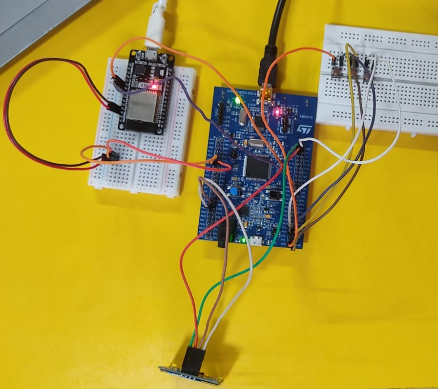
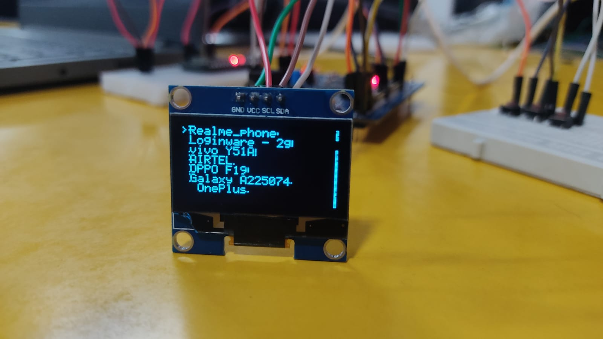
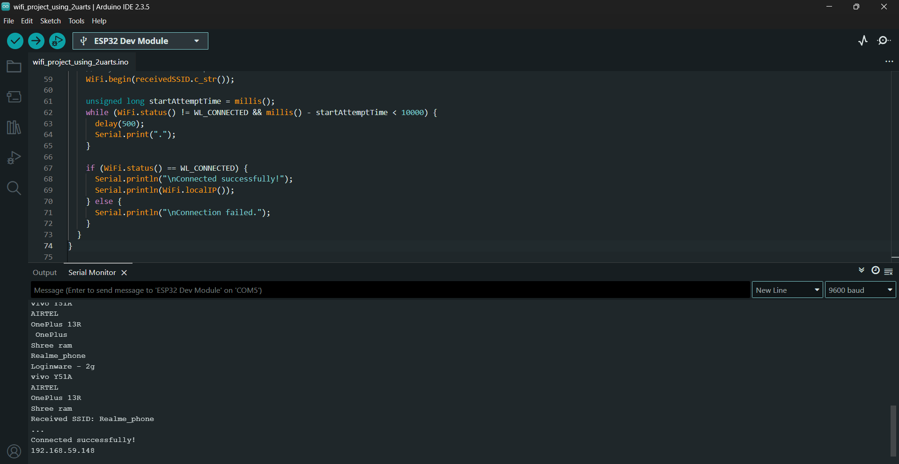

# Wi-Fi Scanning and Connection System Using ESP32 & STM32


A complete embedded system that allows users to **scan nearby Wi-Fi networks** and **connect to the desired one** using only three tactile buttons and an OLED display.

Developed during my **Embedded Systems Internship at Loginware Softwares**.

---

## 🌟 Features

- **Real-time Wi-Fi scanning**: ESP32 scans 2.4 GHz spectrum and serializes SSID lists over UART.
- **Dynamic OLED Menu**: Scrolling list displayed on an SSD1306 0.96" I2C OLED display (128x64).
- **Physical Navigation**: Three-button interactive UI with **Up ↑**, **Down ↓**, and **Select ✔** controls.
- **Inter-MCU Communication**: Bidirectional UART pipeline between STM32 (host controller & UI driver) and ESP32 (network processor).
- **Non-blocking Firmware**: Responsive debounce handling and efficient screen redraws.

---

## 🛠️ Hardware Specifications

| Component | Model / Type | Interface | Role |
|---|---|---|---|
| **Host MCU** | STM32F407VGT6 (ARM Cortex-M4) | I2C / UART / GPIO | UI State Machine & Display Driver |
| **Wireless Module** | ESP32 DevKitC / NodeMCU | UART | Wi-Fi Scan & Connection Engine |
| **Display** | 0.96" SSD1306 OLED (128x64) | I2C (Address 0x78) | Interactive Graphical Menu |
| **Input Buttons** | 3× Tactile Push Buttons | GPIO Inputs | Up, Down, Select Navigation |

---

## 📸 System Architecture & Wiring

### Circuit Connection Diagram


|  |  |
|:---:|:---:|
| **OLED Selection Interface** | **ESP32 Serial Diagnostics** |

### Pinout Connections

#### 1. STM32 to ESP32 (UART Inter-MCU Communication)
```plaintext
STM32F407 (USART2)          ESP32 DevKit
PA2 (USART2_TX)       ──►   GPIO3 (RX)
PA3 (USART2_RX)       ◄──   GPIO1 (TX)
GND                   ───   GND
```

#### 2. STM32 to OLED (SSD1306 I2C Interface)
```plaintext
STM32F407 (I2C2)            OLED (SSD1306)
PB10 (I2C2_SCL)       ──►   SCL
PB11 (I2C2_SDA)       ──►   SDA
3.3V / 5V             ──►   VCC
GND                   ──►   GND
```

#### 3. Navigation Buttons (Active Low / Pulled to GND on Press)
```plaintext
Button Function             STM32 GPIO Pin
Up Button (↑)         ──►   PD10
Down Button (↓)       ──►   PD11
Select Button (✔)     ──►   PD12
```

---

## 📂 Repository Structure

```plaintext
STM32-Project/
├── ESP_Code_Wifi_Project/     # ESP32 Arduino sketch for scanning & connecting to Wi-Fi
│   └── ESP_Code_Wifi_Project.ino
├── WifiScan_Project/          # STM32CubeIDE HAL project for STM32F407VGT6
│   ├── Core/
│   │   ├── Inc/               # main.h, oled.h, HAL configurations
│   │   └── Src/               # main.c (state machine), oled.c (SSD1306 driver)
│   ├── STM32F407VGTX_FLASH.ld # Linker script
│   └── WifiScan_Project.ioc   # STM32CubeMX peripheral configuration
├── images/                    # Schematics, hardware images, and demo video
└── README.md
```

---

## 🚀 How to Build and Flash

### 1. Flash the ESP32:
1. Open [`ESP_Code_Wifi_Project/ESP_Code_Wifi_Project.ino`](file:///e:/Embedded%20&%20Electronics/github/STM32-Project/ESP_Code_Wifi_Project/ESP_Code_Wifi_Project.ino) in **Arduino IDE** or **PlatformIO**.
2. Select Board: `ESP32 Dev Module`.
3. Select your ESP32 COM port and click **Upload**.

### 2. Flash the STM32F407:
1. Open **STM32CubeIDE** and choose `File -> Open Projects from File System...`.
2. Browse to and import [`WifiScan_Project/`](file:///e:/Embedded%20&%20Electronics/github/STM32-Project/WifiScan_Project).
3. Connect your ST-LINK programmer to the STM32 board.
4. Click **Build** (`Ctrl+B`) and then **Run / Flash** (`Ctrl+F11`).

### 3. Running the System:
* Power on both boards. The ESP32 will scan for Wi-Fi access points and send discovered SSIDs over UART to the STM32.
* Use the **Up (PD10)** and **Down (PD11)** buttons to scroll through the network list on the OLED.
* Press **Select (PD12)** to confirm and initiate network connection.
